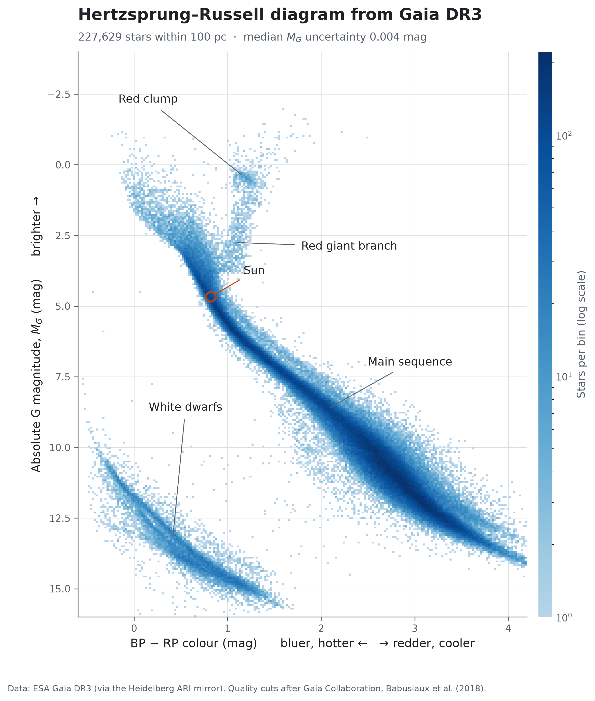

# Hertzsprung–Russell diagram from real Gaia data

A Python pipeline that downloads real stellar measurements from ESA's Gaia DR3 catalogue, turns parallax into distance and apparent brightness into absolute brightness, and plots the Hertzsprung–Russell (HR) diagram of the Sun's neighbourhood.



## Run it

```bash
python3 -m venv .venv && source .venv/bin/activate
pip install -r requirements.txt
python gaia_hr_diagram.py            # stars within 100 pc
open figures/hr_diagram.png          # macOS
```

The first run queries the Gaia archive and caches the result in `data/` (one file per source, so switching source never mixes data). The archive searches the whole catalogue, which can take anywhere from a minute to 30+ minutes when it is busy, so keep your Mac awake and let it run. It prints a status line as it goes. Later runs reuse the cache, so you can tweak the plot instantly.

| Option | What it does |
|---|---|
| `--max-distance 200` | Stars out to 200 pc instead of 100 pc. Bigger download, more giants. |
| `--refresh` | Ignore the cache and query the archive again. |
| `--source ari` | Get the same data from a Heidelberg University mirror of Gaia DR3 instead of ESA's archive. Handy if ESA's is slow. |
| `--timeout 90` | Wait up to 90 minutes for the archive (default 60). It searches the whole catalogue, so it can be slow when the archive is busy. |
| `--data my_file.csv` | Use your own CSV instead of querying (needs the columns listed in `COLUMNS`). |
| `--no-annotations` | Plot without the feature labels and the Sun marker. |
| `--out path.png` | Save the figure somewhere else. |

## The physics

**Distance.** Gaia measures each star's parallax, the tiny shift in its position as the Earth orbits the Sun. With parallax `p` in milliarcseconds, the distance is `d = 1000 / p` parsecs.

**Absolute magnitude.** A star's apparent magnitude `G` depends on how far away it is. The distance modulus removes that:

```
M_G = G − 5 log10(d / 10 pc) = G + 5 log10(p) − 10      (p in mas)
```

`M_G` is what the star would look like at 10 pc, so it measures true luminosity.

**Colour.** `BP − RP` is the difference between Gaia's blue and red photometer magnitudes. Hot stars are bluer (small `BP − RP`) and cool stars are redder, so colour stands in for temperature.

**Uncertainty.** Propagating the parallax error gives `σ_M = (5 / ln 10) · σ_p / p ≈ 2.17 · σ_p / p`. Requiring `p / σ_p > 10` therefore guarantees `σ_M < 0.22` mag for every star plotted. The script prints the actual median.

## Quality cuts

Taken from Gaia Collaboration, Babusiaux et al. (2018), *A&A* 616, A10, Section 2.1 (the Gaia DR2 HR diagram paper), applied to DR3:

| Cut | Why |
|---|---|
| `parallax_over_error > 10` | Precise distances, so `1/parallax` is a good distance estimate |
| `visibility_periods_used > 8` | Star observed on enough separate occasions |
| `phot_g_mean_flux_over_error > 50` | Precise G magnitude (σ_G < 0.022 mag) |
| `phot_bp_mean_flux_over_error > 20`, `phot_rp_mean_flux_over_error > 20` | Precise colour (σ < 0.054 mag) |
| `1.0 + 0.015 (BP−RP)² < phot_bp_rp_excess_factor < 1.3 + 0.06 (BP−RP)²` | Removes sources whose BP and RP fluxes are contaminated by neighbours |
| `√(χ² / (ν−5)) < 1.2 · max(1, exp(−0.2 (G−19.5)))` | Removes poor astrometric fits (`χ² = astrometric_chi2_al`, `ν = astrometric_n_good_obs_al`) |

All but the last are applied in the archive query. The last is applied in pandas (`astrometric_cut`), where it is easy to read and test.

## Reading the diagram

- **Main sequence:** the diagonal band where stars fuse hydrogen in their cores, including the Sun. Position along it is set by mass.
- **Red giant branch and red clump:** evolved stars that have run out of core hydrogen and swollen up. They are cool (red) but very luminous, so they sit above the main sequence. The clump is where stars fuse helium in their cores.
- **White dwarfs:** the faint, hot remnants of Sun-like stars, well below the main sequence.

The Sun is marked at approximately `BP − RP = 0.82`, `M_G = 4.67` (Casagrande & VandenBerg 2018).

## Limitations

- **No extinction correction.** Interstellar dust dims and reddens starlight. Within about 200 pc this is small, but for larger `--max-distance` values it will smear the diagram.
- **Parallax zero-point.** Gaia DR3 parallaxes carry a small systematic offset of roughly −0.02 mas. At 100 pc (10 mas) that is about 0.2%, so it is negligible here, but it grows for distant stars. The official correction (Lindegren et al. 2021) depends on magnitude, colour and sky position.
- **Selection effects.** A volume-limited sample is dominated by faint, common red dwarfs. Giants are rare, so a 100 pc sample shows few of them. The quality cuts also remove some genuine stars, particularly in crowded regions.
- **Binaries.** Unresolved binary systems appear brighter than single stars of the same colour, forming a faint second band just above the main sequence.
- **Distance from `1/parallax`** is only reliable when the fractional parallax error is small, which is what the `parallax_over_error > 10` cut ensures.

## Tests

```bash
python test_gaia_hr.py
```

The tests need no internet. They check the distance-modulus maths against hand-calculable cases (a star at 10 pc has `M = m`), check the astrometric cut at its thresholds, and run the whole pipeline on a synthetic catalogue with known true magnitudes to confirm they are recovered exactly. They test the code, not the astrophysics; the real data is what tests the astrophysics.

## Ideas to extend it

- Apply the official parallax zero-point correction (`gaiadr3-zeropoint` package) and see what changes.
- Overlay an open cluster (Hyades or Pleiades) to show a main-sequence turn-off and estimate its age.
- Use `teff_gspphot` to add lines of constant radius, or to convert colour into temperature.
- Increase `--max-distance` to 500 pc and compare how the red giant branch fills in against the 100 pc sample.

## Credits

This work uses data from the European Space Agency (ESA) mission [Gaia](https://www.cosmos.esa.int/gaia), processed by the Gaia Data Processing and Analysis Consortium (DPAC).

- Gaia Collaboration, Prusti et al. (2016), *A&A* 595, A1 (the Gaia mission)
- Gaia Collaboration, Vallenari et al. (2023), *A&A* 674, A1 (Gaia DR3)
- Gaia Collaboration, Babusiaux et al. (2018), *A&A* 616, A10 (observational HR diagrams; source of the quality cuts)
- Casagrande & VandenBerg (2018), *MNRAS* 479, L102 (the Sun in Gaia bands)
